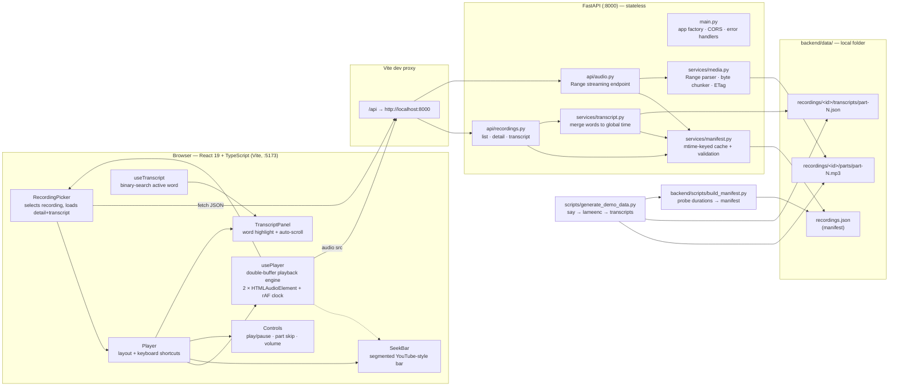

# 01 — Architecture

## 1. System overview

Two processes, no infrastructure. Audio and transcripts live as plain files; a JSON
manifest is the single source of truth. The frontend owns all playback intelligence; the
backend is a stateless file-streaming + metadata service.



## 2. The core idea — Unified Virtual Timeline

The player never "plays five files". It plays **one virtual track** whose length is the
sum of all part durations. Every part declares where it sits on that track.

```
parts:        [  P1 44.25s  ][  P2 44.77s  ][  P3 51.57s  ][  P4 43.10s  ][  P5 48.22s  ]
global time:  0          44.25          89.02         140.59         183.69         231.92
              ▲              ▲              ▲              ▲              ▲              ▲
seek bar:     segment 1      segment 2      segment 3      segment 4      segment 5
```

Two pure functions (frontend/src/utils/timeline.ts) do all the math:

- `partIndexAt(parts, t)` — binary search: which part does global time `t` belong to?
- `globalTime = part.start + audioElement.currentTime` — recomputed every animation frame.

Everything else (transcript sync, seek bar fills, time display) is a **projection of this
single number**, which is why the UI never drifts out of sync internally.

## 3. Data model

### 3.1 File layout

```
backend/data/
├── recordings.json                          # manifest — single source of truth
└── recordings/
    └── demo-consultation-001/
        ├── parts/
        │   ├── part-1.mp3 … part-5.mp3      # 128 kbps mono 22.05 kHz
        └── transcripts/
            └── part-1.json … part-5.json    # Whisper word_timestamps format
```

### 3.2 Manifest (backend/data/recordings.json)

Written once by `build_manifest.py`, which **probes real durations** with `mutagen` and
caches them. The API never probes files per-request.

```json
{
  "recordings": [
    {
      "id": "demo-consultation-001",
      "title": "Consultation — Patient Intake",
      "parts": [
        { "index": 1, "file": "parts/part-1.mp3", "duration": 44.251 },
        { "index": 2, "file": "parts/part-2.mp3", "duration": 44.77 }
      ]
    }
  ]
}
```

### 3.3 Per-part transcript (as stored)

Timestamps are **relative to the part** — exactly what Whisper emits:

```json
{ "part": 1, "duration": 44.251,
  "words": [ { "word": "Good", "start": 0.18, "end": 0.414 } ] }
```

### 3.4 Merged transcript (as served)

`services/transcript.py` re-bases every word to **global time** by adding the part's
start offset, so the frontend does zero offset arithmetic:

```json
{ "recordingId": "demo-consultation-001", "totalDuration": 231.915,
  "parts":   [ { "index": 1, "duration": 44.251, "start": 0.0, "end": 44.251 }, … ],
  "words":   [ { "word": "Good", "start": 0.18, "end": 0.414, "part": 1 }, … ] }
```

## 4. Backend architecture

### 4.1 Layers

```
Request ──► main.py (CORS, /api prefix, ManifestError→503 handler)
              ├── api/recordings.py   list / detail / transcript   (JSON, pydantic camelCase)
              ├── api/audio.py        GET+HEAD /parts/{n}/audio    (200 or 206 bytes)
              └── api/download.py     POST /merge · GET /download  (merged single MP3)
                      ├── services/manifest.py   load+validate manifest (cached on mtime)
                      ├── services/transcript.py part transcripts → merged global words
                      ├── services/merge.py      byte-concat parts → merged.mp3 (stale-aware cache)
                      └── services/media.py      Range parser · byte chunker · ETag
                                  └── settings.chunk_size = 64 KB streaming chunks
```

### 4.2 Range streaming (the heart of the audio endpoint)

`services/media.py::parse_range(header, file_size)` implements RFC 7233 for the cases
browsers actually send:

| Header | Result |
|--------|--------|
| *(absent)* | `None` → serve whole file, `200` |
| `bytes=0-1023` | `ByteRange(0, 1023)` → `206` |
| `bytes=500-` | `ByteRange(500, size-1)` → `206` |
| `bytes=-500` | last 500 bytes → `206` |
| `bytes=-99999` (suffix > file) | whole file → `206` |
| `bytes=99999999-` | `UnsatisfiableRange` → `416` + `Content-Range: bytes */size` |
| `items=0-5`, `bytes=-`, `bytes=-0` | `None` or `416` per spec |

The endpoint then streams only those bytes in 64 KB chunks (`file_chunks()`), with
`Accept-Ranges`, `ETag` (`"<size:x>-<mtime:x>"`), `Cache-Control: public, max-age=3600`
and `Content-Range` headers. Browsers use this for both scrubbing and buffering.

### 4.3 Manifest caching & invalidation

`get_manifest()` remembers the file's `st_mtime_ns`; `lru_cache` is cleared whenever it
changes. Result: zero disk I/O on the hot path, but editing the manifest on disk takes
effect immediately without a server restart.

### 4.4 Security

- **Path traversal**: audio paths never come from URL fragments — the part index must
  exist in the manifest, and `part_file()` additionally verifies the resolved path stays
  inside the recording directory (`Path.is_relative_to`).
- **CORS**: explicit allow-list (`localhost:5173`), GET/HEAD/OPTIONS only, with
  `Content-Range`/`ETag` exposed.
- Consistent machine-readable errors: `{"detail": {"code": "...", "message": "..."}}`.

## 5. Frontend architecture

### 5.1 Component tree

```
App
└── RecordingPicker              fetches list, detail + transcript in parallel
    └── Player                   wires engine ↔ UI, global keyboard shortcuts
        ├── TranscriptPanel      sentence lines, part chips, active word highlight
        ├── SeekBar              segmented bar, pointer-capture drag, hover tooltip
        ├── Controls             play/pause, part ±, seek ∓5s, speed, mute, time, volume
        └── DownloadButton       POST /merge → blob download of merged MP3
```

### 5.2 usePlayer — the engine (hooks/usePlayer.ts)

The only stateful playback logic in the app. Key structures:

| Element | Purpose |
|---------|---------|
| `audioA` / `audioB` | two `<audio>` elements; roles swap at boundaries |
| `activeEl` / `standbyEl` refs | which is currently "live" |
| `activeIdx` ref | 0-based index of the live part |
| `playingRef` | mirrors `playing` state for use inside the rAF loop (no stale closures) |
| rAF tick loop | the **single time source**: computes `globalTime`, triggers transitions |

The engine exposes one flat controller: `{ playing, globalTime, activePart, duration,
bufferedEnd, play, pause, toggle, seek, skipPart, setVolume }`. Components are pure
projections of this object.

### 5.3 Word sync (hooks/useTranscript.ts)

`findWordIndex(words, t)` — binary search for the last word with `start ≤ t`, active
while `t ≤ end`. Runs per animation frame over 665 words: ~10 comparisons, negligible.
`TranscriptPanel` memo-renders spans; the active word gets `.active` (accent background)
and auto-scrolls via `scrollIntoView({block:'nearest'})`.

## 6. File map

| Path | Role |
|------|------|
| `run.sh` | one-command bootstrap: venv, deps, demo data, both servers |
| `scripts/generate_demo_data.py` | `say` → WAV → lameenc MP3 → synthetic word timings → manifest |
| `backend/scripts/build_manifest.py` | rescan recordings dir, probe durations, write manifest |
| `backend/app/main.py` | app factory, CORS, health, ManifestError handler |
| `backend/app/core/config.py` | pydantic-settings (env `SCRIBBLE_*`), paths, chunk size |
| `backend/app/api/recordings.py` | list / detail / transcript endpoints |
| `backend/app/api/audio.py` | Range streaming endpoint (GET + HEAD) |
| `backend/app/api/download.py` | merge + download endpoints |
| `backend/app/services/manifest.py` | manifest cache, validation, path safety |
| `backend/app/services/transcript.py` | global-time word merge |
| `backend/app/services/merge.py` | part concatenation with stale-aware caching |
| `backend/app/services/media.py` | RFC 7233 Range parsing, chunked streaming, ETag |
| `backend/app/models/schemas.py` | pydantic camelCase response models |
| `backend/tests/conftest.py` | shared API test fixture (temp data dir + real tiny MP3s) |
| `backend/tests/test_media.py` | 11 Range-parser unit tests |
| `backend/tests/test_api.py` | 12 API tests incl. byte-accuracy of 206 responses |
| `backend/tests/test_merge.py` | 7 merge/download tests (byte identity, cache reuse, staleness) |
| `frontend/src/hooks/usePlayer.ts` | double-buffer playback engine |
| `frontend/src/hooks/useTranscript.ts` | active-word lookup |
| `frontend/src/components/SeekBar.tsx` | segmented seek bar + drag/hover/tooltip |
| `frontend/src/components/Controls.tsx` | transport controls (seek ∓5s, speed, mute, volume) |
| `frontend/src/components/TranscriptPanel.tsx` | synced transcript |
| `frontend/src/components/DownloadButton.tsx` | merge-then-download flow |
| `frontend/src/components/Player.tsx` | composition + keyboard shortcuts |
| `frontend/src/components/RecordingPicker.tsx` | data loading + recording selection |
| `frontend/src/utils/timeline.ts` | pure timeline math + tests |
| `frontend/vite.config.ts` | dev proxy `/api` → :8000 |
