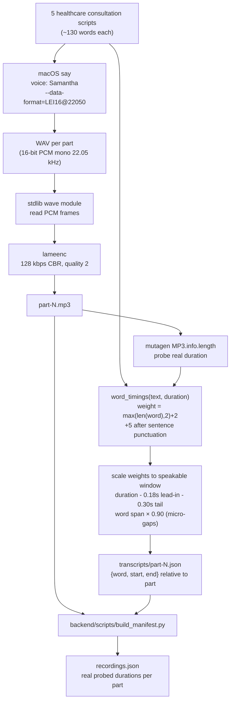
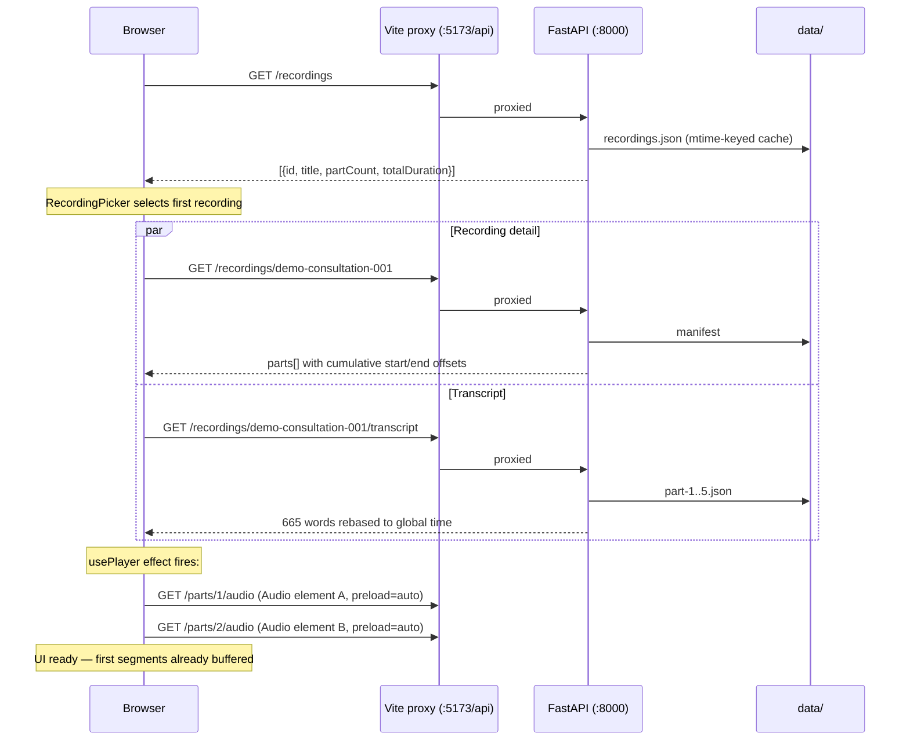
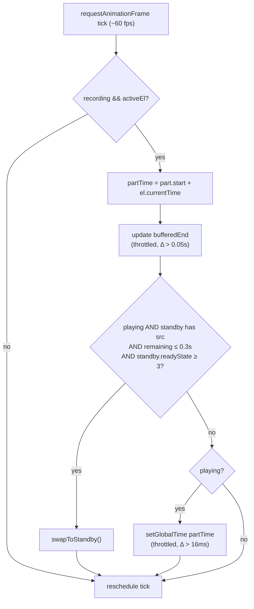
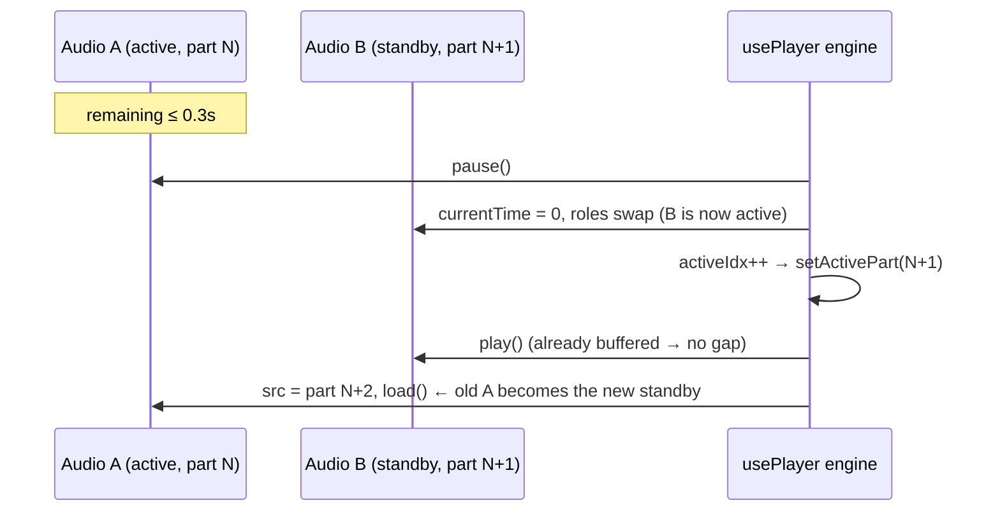
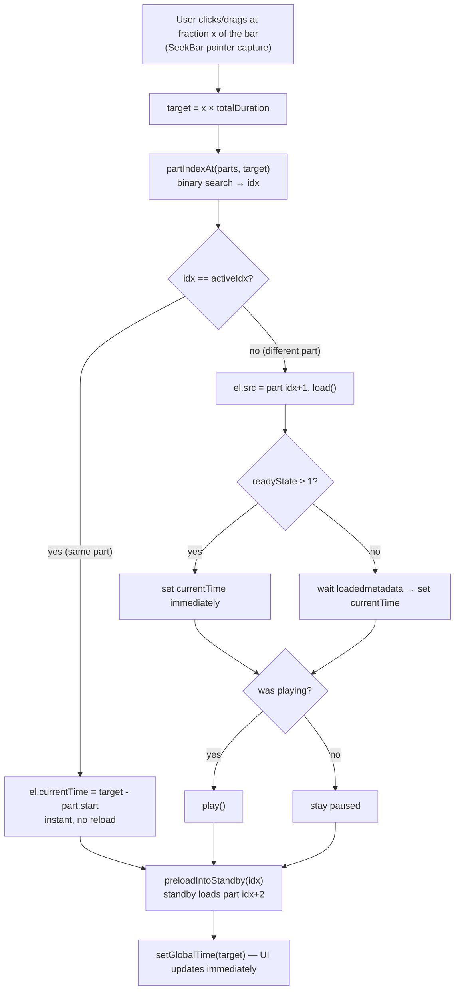
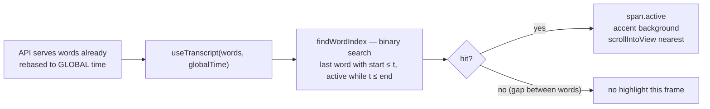
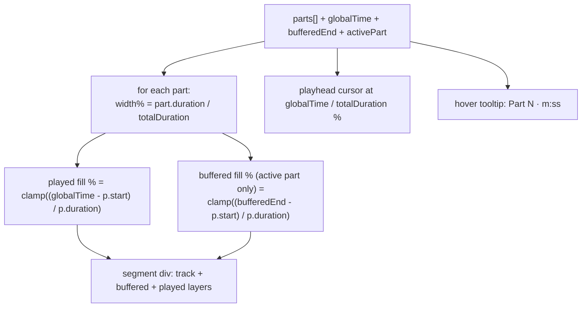
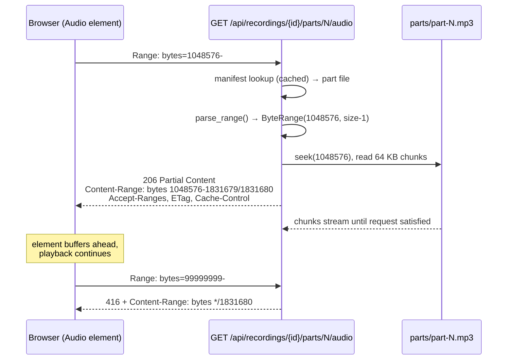
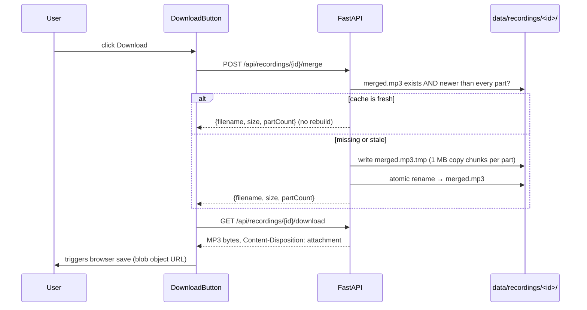

# 02 — Flows

End-to-end flow diagrams. All diagrams match the implemented code (function/variable
names are real).

---

## 1. Demo data generation (one-time, offline)

`scripts/generate_demo_data.py` — no network, no ffmpeg, entirely on-device.

Word timings are **synthetic** (deterministic distribution by word length). They align
perfectly with the generated speech because both derive from the same script and the same
measured duration. The production path — Whisper `word_timestamps=True` — produces the
identical JSON shape, so nothing downstream changes.

---

## 2. App boot & data loading

---

## 3. The rAF tick loop (heartbeat of the player)

Runs continuously while a recording is loaded. This is the **only** place global time is
read, so every UI surface agrees by construction.

Every state write is delta-throttled so React re-renders only when a value actually moved.

---

## 4. Seamless part transition (the swap)

The whole point of double-buffering: the next part is already loaded when the current one
runs out.

Fallback path: if buffering is slow and the element fires `ended` before the swap, the
`ended` handler performs the same `swapToStandby()` (or stops the player if it was the
last part). The 0.3 s threshold + `readyState ≥ 3` check make the fallback rare in
practice since parts are small local MP3s.

---

## 5. Seeking (unified seek bar → correct part + offset)

Keyboard: `←`/`→` = seek ±5 s · `J`/`L` = previous/next part (`skipPart` → `seek(part.start)`).

---

## 6. Word-level transcript sync

Why no drift: `globalTime` comes from the audio element's own clock via the rAF loop —
there is exactly one clock in the system. Word timestamps from the server are absolute on
that same timeline, so highlight accuracy equals timestamp accuracy (~±50 ms here).

Bonus: words are clickable — `onClick → seek(word.start + 0.01)`.

---

## 7. Seek bar rendering (per animation frame)

Segments are 2 px apart (`flex` + `gap`) — the "YouTube chapters" look. A single
`onPointerDown` + `setPointerCapture` handles click **and** drag scrubbing with one code
path; dragging calls `seek()` on every pointermove (cheap: same-part seeks only set
`currentTime`).

---

## 8. HTTP Range request lifecycle

---

## 9. Merge & download (full-audio export)

Staleness rule: any `part-N.mp3` with `mtime > merged.mp3` mtime forces a rebuild, so
swapping a part's file automatically refreshes the next download. Concurrency-safe via
temp-file + atomic rename.

---

## 10. Error paths

| Scenario | Behaviour |
|----------|-----------|
| `recordings.json` missing | backend returns `503 MANIFEST_UNAVAILABLE`; UI shows the fix (`run generate_demo_data.py`) |
| Unknown recording / part id | `404 RECORDING_NOT_FOUND` / `PART_NOT_FOUND`; UI surfaces message |
| Malformed Range header | silently served as full `200` (spec-compliant leniency) |
| Unsatisfiable Range | `416` with `Content-Range: bytes */size` |
| Audio element fails to play (autoplay policy) | `play()` promise rejection swallowed; state stays paused, user gesture retries |
